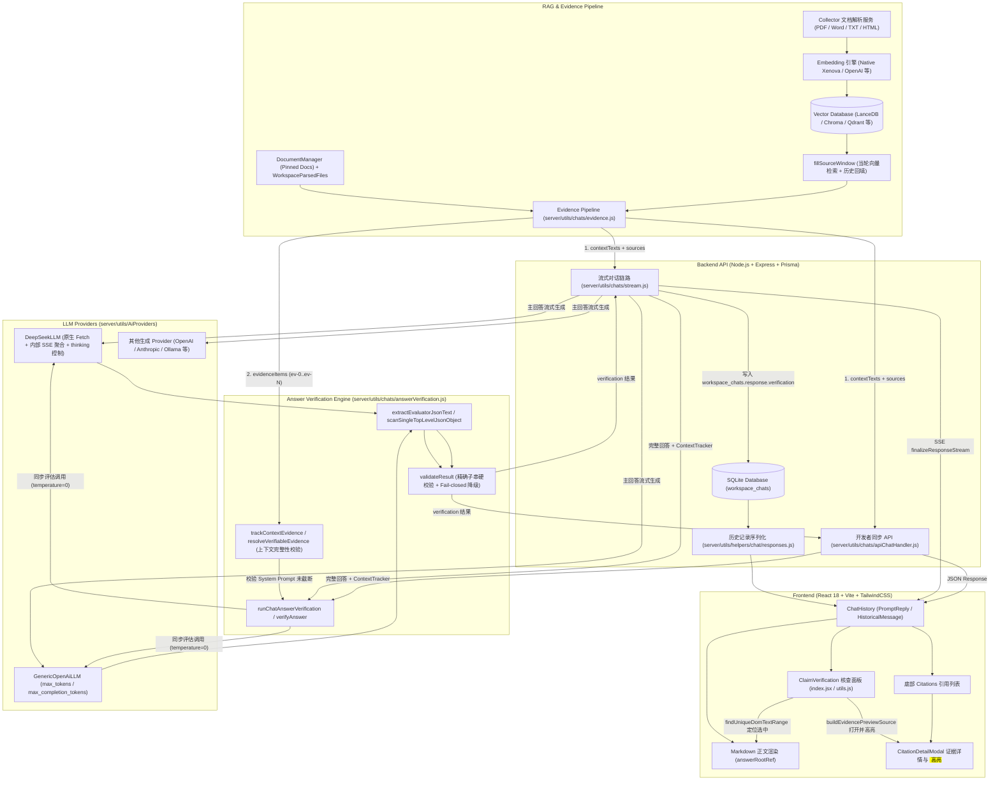
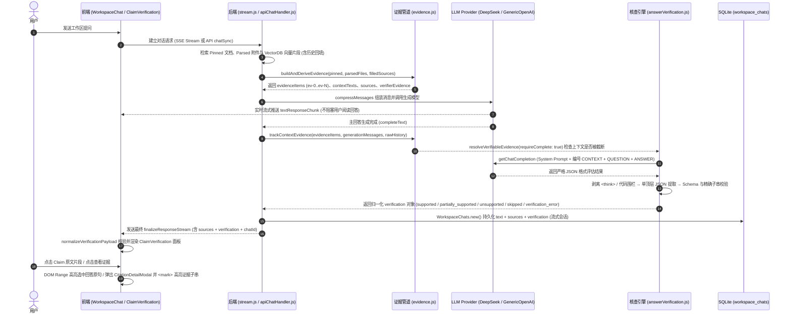

# KnowledgeHub — Evidence-based Enterprise RAG Knowledge Base

**基于证据追溯与事实陈述级核查的企业级 RAG 知识库系统**

[](./LICENSE)
[](./package.json)
[](https://github.com/Mintplex-Labs/anything-llm)

> **项目声明**：**KnowledgeHub** 是基于开源项目 [`Mintplex-Labs/anything-llm`](https://github.com/Mintplex-Labs/anything-llm) 进行二次开发的企业级知识库增强项目（当前开发分支：`feature/rag-answer-verification`）。本项目在保留上游多文档采集、多向量库检索与多模型对话能力的基础上，重点设计并实现了**统一证据链构建（Evidence Pipeline）**、**事实陈述级答案核查（Claim-level Answer Verification）**、**Claim → Evidence 精确子串映射与溯源高亮**以及 **DeepSeek / Generic OpenAI 核查适配器**。

---

## 目录

- [1. 项目介绍](#1-项目介绍)
- [2. 核心功能](#2-核心功能)
- [3. 项目演示](#3-项目演示)
- [4. 系统架构](#4-系统架构)
- [5. 核心数据流](#5-核心数据流)
- [6. 核心技术实现](#6-核心技术实现)
- [7. 技术栈](#7-技术栈)
- [8. 快速启动](#8-快速启动)
- [9. 测试](#9-测试)
- [10. 当前限制](#10-当前限制)
- [11. 上游项目与 License](#11-上游项目与-license)

---

## 1. 项目介绍

### 1.1 背景与痛点
传统的企业级 RAG（Retrieval-Augmented Generation）系统通常止步于**“生成回答 + 附上检索到的文档列表（Citations）”**：
- 用户知道系统检索了哪些文档切片（Chunks），但无法直观判断**回答中的哪一句事实陈述（Claim）是由哪一段证据（Evidence）支撑的**。
- 当检索结果包含多篇文档、置顶文档（Pinned Documents）、会话附件（Parsed Files）以及历史对话回填上下文（History Backfill）时，模型回答可能夹杂过度推断或无依据拼凑。
- 用户若要核实某项具体数据或条款，必须逐一打开底部的引用卡片人工通读比对，核查成本极高。

### 1.2 KnowledgeHub 的目标与核心价值
**KnowledgeHub** 定位为 **Evidence-based Enterprise RAG Knowledge Base（基于证据追溯的企业知识库）**，面向企业规章制度问答、技术文档检索、合规审计与内部知识助手等高可靠性场景，在生成式回答之上建立**“事实陈述（Claim）→ 证据片段（Evidence）”**的细粒度可追溯链路：

| 维度 | 传统 RAG 知识库（原生 AnythingLLM） | KnowledgeHub（二次开发增强） |
| :--- | :--- | :--- |
| **溯源粒度** | 整条回答对应一组文档级 Citations | 细化至单条事实陈述（Claim）到具体证据片段（Evidence Quote）的映射 |
| **多源证据追踪** | 检索切片、置顶文档、附件、历史回填分散拼装 | 统一构建带 `ev-0, ev-1, ...` 标识与来源标签（`pinned` / `attachment` / `retrieval` / `history`）的冻结证据集 |
| **幻觉与越界检测** | 依赖人工阅读 Citations 核对 | 自动提取事实陈述并做两阶段校验（LLM 评估 + 后端精确子串硬校验） |
| **上下文截断感知** | 提示词超长被截断时静默降级 | 追踪实际送入生成模型的 System Prompt，一旦发生上下文截断立即标记 `skipped (evaluation_context_not_preserved)` |
| **前端交互体验** | 仅支持底部 Citations 弹窗查看全文 | 支持核查面板展开、点击 `answerQuote` 在回答正文中定位选中、点击证据弹窗并 `<mark>` 高亮精确引文、失配时安全回退文本快照 |
| **安全性与容错** | — | Fail-closed 设计：绝不篡改原始回答与引用列表；支持 SSE 流式输出、数据库持久化与历史会话完整恢复 |

---

## 2. 核心功能

以下功能均已在当前分支（`feature/rag-answer-verification`）中完整实现并通过自动化测试验证：

1. **多源知识库检索与 AI 问答**
   - 继承 AnythingLLM 的 Workspace 文档管理、向量检索、置顶文档（Pinned Documents）、会话附件解析（Parsed Files）与多轮对话能力。
2. **统一证据管道（Unified Evidence Pipeline）**
   - 在每次问答请求内，按照送入生成模型 System Prompt 的真实顺序，将四类上下文统一封装为带请求级唯一 ID（`ev-0`, `ev-1`, ...）的不可变证据项（`EvidenceItem`）：
     - `pinned`：工作区置顶文档
     - `attachment`：当前会话上传的解析附件
     - `retrieval`：当前轮次向量数据库检索命中的文档切片
     - `history`：多轮对话由 `fillSourceWindow` 从历史记录回填的向量切片
3. **事实陈述（Claim）自动提取与细粒度核查**
   - 针对非空 RAG 回答，自动调用评估器提取事实陈述列表（`claims`），并对每条陈述给出三态判定（`verdict`）：
     - `supported`（有据支持）
     - `unsupported`（缺乏依据）
     - `uncertain`（存疑）
   - 汇总生成整条回答的核查状态（`status`）：
     - `supported`（已核实：全部提取陈述均有确切证据支持）
     - `partially_supported`（部分支持：存在已支持陈述，同时含存疑或缺乏依据陈述）
     - `unsupported`（存疑 / 缺乏依据：没有任何一条陈述获得有效证据支持）
     - `skipped`（未核查：未启用、无上下文、无模型、上下文被截断或超预算等，附带明确 `skipReason`）
     - `verification_error`（核查未完成：超时、JSON 格式无效、Schema 校验失败等，附带 `error.code`）
4. **Claim → Evidence 映射与双向定位**
   - **回答正文定位**：后端在剔除 `<think>` 思考块后的可见回答文本中计算 `answerQuote` 的精确字符区间（`answerLocation`：`located` / `ambiguous` / `not_found`）。当状态为唯一匹配（`located`）时，用户在前端点击“回答原文片段”即可跨 Markdown 内联标签（如 `<strong>`、`<code>`）在 DOM 中自动滚动并高亮选中对应语句。
   - **证据原文 `<mark>` 高亮**：用户点击任一 Claim 下的证据卡片，即弹出 [`CitationDetailModal`](./frontend/src/components/WorkspaceChat/ChatContainer/ChatHistory/Citation/index.jsx)，展示对应文档切片全文，并通过纯文本切片算法（[`sliceTextForHighlight`](./frontend/src/components/WorkspaceChat/ChatContainer/ChatHistory/ClaimVerification/utils.js)）将核查引文（`quote`）用 `<mark>` 精确高亮并自动滚动至可视区域中央。
5. **文本快照安全回退（Text Snapshot Fallback）**
   - 当某条证据源自历史回填上下文（`origin: "history"`，不在当前轮底部 Citations 中展示）、会话附件（`origin: "attachment"`，无 `documentId`），或前端 `messageSources` 中无法通过唯一 `evidenceId` / `documentId + chunkId` 可靠关联到原始切片时，前端不会按文件名猜测关联，而是自动降级为**文本快照模式**（标记 `文本快照` / `历史上下文` 徽章），直接渲染经后端校验过的 `evidence.quote`，确保核查依据始终可查阅且不发生张冠李戴。
6. **核查结果持久化与历史消息恢复**
   - 在普通工作区流式问答（[`server/utils/chats/stream.js`](./server/utils/chats/stream.js)）中，核查结果在主回答文本流完成后生成，随最终 `finalizeResponseStream` SSE 事件下发前端，并同步写入 SQLite 数据库 `workspace_chats.response` JSON 的 `verification` 字段。
   - 刷新页面或重新进入历史会话时，[`convertToChatHistory`](./server/utils/helpers/chat/responses.js) 自动恢复每条历史消息的 `verification` 对象。
   - 在开发者 API 同步接口 `POST /api/v1/workspace/:slug/chat`（[`server/utils/chats/apiChatHandler.js`](./server/utils/chats/apiChatHandler.js)）中，核查结果直接包含在 HTTP 响应体中返回（保持上游数据库写入契约不变）。
7. **DeepSeek 与 Generic OpenAI 核查适配**
   - 针对 [`DeepSeekLLM`](./server/utils/AiProviders/deepseek/index.js) 进行了深度适配：注入 Node.js 原生 `globalThis.fetch` 与 `Connection: close` 规避长耗时生成后的连接池复用断连（`UND_ERR_SOCKET`）；内部将同步核查请求转为 SSE 流式聚合（`stream: true`）并在检测到完整 JSON 包络后安全收敛；针对支持思考开关的模型（如 `deepseek-flash`）在有输出预算限制时自动下发 `thinking: { type: "disabled" }`，防止 `<think>` 推理块耗尽 `max_tokens`（`4096`）导致 JSON 主体为空。

---

## 3. 项目演示

### 3.1 项目主视觉（上游基础界面）


### 3.2 KnowledgeHub 核心交互演示（截图占位说明）

> **说明**：仓库当前未内置 KnowledgeHub 事实核查面板的静态截图文件。为保证文档真实性，此处不引用虚构图片路径。启动项目并开启 `RAG_ANSWER_VERIFICATION_ENABLED="true"` 后，可在工作区对话界面体验并补充以下三类核心视图截图：

1. **普通知识库回答与核查状态摘要栏（占位：`docs/screenshots/knowledgehub-summary-banner.png`）**
   - **展示内容**：AI 流式生成回答正文下方、底部 Citations 引用栏上方展示 [`ClaimVerification`](./frontend/src/components/WorkspaceChat/ChatContainer/ChatHistory/ClaimVerification/index.jsx) 摘要条，包含状态徽章（如 `已核实` / `部分支持` / `存疑`）、计数统计 pill（`支持 X` / `存疑 Y` / `缺乏依据 Z`）以及固定范围声明 `核查范围：仅针对模型提取的事实陈述（不改写原始回答）`。
2. **ClaimVerification 事实核查展开面板（占位：`docs/screenshots/knowledgehub-claim-panel.png`）**
   - **展示内容**：展开核查详情后，逐卡展示提取出的每条事实陈述（`claim`）、单条判定徽章、可点击定位的“回答原文片段”（`answerQuote`）、判定说明（`reason`）以及关联的证据卡片列表（含文档标题、`检索片段` / `置顶文档` / `对话附件` / `历史上下文` 来源徽章、`文本快照` 标识及证据引文预览）。
3. **CitationDetailModal 证据原文高亮弹窗（占位：`docs/screenshots/knowledgehub-evidence-highlight.png`）**
   - **展示内容**：点击证据卡片上的“查看证据”后弹出的模态框，头部显示来源类型徽章与 `已高亮核查命中片段` 提示，正文中将支撑该 Claim 的精确子串以黄色高亮框（`<mark>`）标记并自动居中滚动定位。

---

## 4. 系统架构

下图展示了 **KnowledgeHub** 的整体系统架构，重点体现了新增的**统一证据管道（`evidence.js`）**、**事实核查引擎（`answerVerification.js`）**、**DeepSeek 适配器增强**与**前端核查溯源组件（`ClaimVerification` & `CitationDetailModal`）**与原有 AnythingLLM RAG 链路的关系：



---

## 5. 核心数据流

### 5.1 端到端问答与核查时序图



### 5.2 四类证据来源与历史上下文处理机制

在 [`server/utils/chats/evidence.js`](./server/utils/chats/evidence.js) 中，系统将进入生成模型上下文的所有文本统一归类为以下 4 种 `origin`（按注入 System Prompt 的先后顺序排列并分配 `ev-0`, `ev-1`, ...）：

| 注入顺序 | `origin` 类型 | 数据来源 | `displayInSources` | 底部 Citations 栏是否显示 | 核查引擎是否可用作证据 | 前端点击预览方式 |
| :---: | :--- | :--- | :---: | :---: | :---: | :--- |
| **1** | `pinned` | `DocumentManager.pinnedDocs()` 工作区置顶文档 | `true` | 显示 | **是** | 优先匹配 `messageSources` 全文并高亮；失配回退文本快照 |
| **2** | `attachment` | `WorkspaceParsedFiles` 当前会话上传的解析附件 | `true` | 显示 | **是**（`documentId: null`） | 因无知识库 `documentId`，固定以**文本快照**（`对话附件` 徽章）安全预览并高亮 |
| **3** | `retrieval` | `VectorDb.performSimilaritySearch` 当前轮向量检索命中切片 | `true` | 显示 | **是** | 通过唯一 `evidenceId` 或 `documentId + chunkId` 匹配切片全文并 `<mark>` 高亮 |
| **4** | `history` | `fillSourceWindow` 从历史对话记录中回填的向量切片 | `false` | **不显示**（保持原生 UI 契约） | **是**（显式白名单放行） | 前端识别 `isHistory: true`，自动构建带 **`历史上下文` + `文本快照`** 徽章的预览弹窗并高亮引文 |

**为什么这样处理历史上下文（`history`）？**
- 在多轮对话中，AnythingLLM 的 `fillSourceWindow` 会把前几轮对话检索过的向量切片回填到当前轮的 `contextTexts` 中送给 LLM，但不会将它们放入当前消息底部的 `sources` 列表（即 `displayInSources: false`），以免底部引用栏无限膨胀。
- 如果模型在当前轮回答中引用了历史回填切片里的事实，而核查器看不到这部分上下文，就会产生“误判为幻觉（False Unsupported）”；反之，如果核查通过后用户在底部 `sources` 里找不到对应文档，点击又会报错。
- **KnowledgeHub 的解决方案**：后端 [`deriveEvidencePayloads`](./server/utils/chats/evidence.js) 允许 `origin === "history" && displayInSources === false` 的证据进入 `verifierEvidence` 参与事实核查；前端 [`buildEvidencePreviewSource`](./frontend/src/components/WorkspaceChat/ChatContainer/ChatHistory/ClaimVerification/utils.js) 对 `origin === "history"` 的证据强制启用文本快照预览並标注 `历史上下文` 徽章，既消除了多轮核查误报，又保证了用户点击时总能看到确切的证据片段。

---

## 6. 核心技术实现

### 6.1 统一 Evidence 数据结构与请求级 `evidenceId`
- **实现文件**：[`server/utils/chats/evidence.js`](./server/utils/chats/evidence.js)
- **核心设计**：
  - `buildAndDeriveEvidence` 先通过 `splitFilledSources` 比对 `pinnedDocIdentifiers` 与 `vectorSearchResults`，将混合的 `filledSources.sources` 拆分为纯粹的当轮检索（`retrieval`）与历史回填（`history`）。
  - 随后由 `buildEvidenceItems` 生成深度冻结（`Object.freeze`）的 `EvidenceItem` 数组，每个元素分配当前请求内唯一的 `evidenceId`（`ev-0`, `ev-1`, ...），并清洗掉内部文件路径（如 `docpath`），仅保留合法的 `http:` / `https:` 外部链接（`sourceUri`）。
  - 生成提示词所需的 `contextTexts`、前端底部展示的 `sources` 以及核查器使用的 `verifierEvidence` **全部由同一份 `evidenceItems` 派生**，从根源上消除了生成上下文与核查上下文的索引偏移。

### 6.2 上下文完整性追踪（Context Preservation Check）
- **实现文件**：[`server/utils/chats/evidence.js`](./server/utils/chats/evidence.js)（`trackContextEvidence`、`resolveVerifiableEvidence`）
- **核心设计**：
  - 当用户的提问或历史消息过长时，AnythingLLM 的 `compressMessages`（基于 `cannonball`）可能会对 System Prompt 执行 `--prompt truncated for brevity--` 中间截断，或者直接丢弃 System Prompt（`system_context_dropped`）。
  - 如果上下文已被截断，核查器拿到的全量 `evidenceItems` 与生成模型实际看到的残缺上下文就不一致。
  - `trackContextEvidence` 会扫描实际送入生成模型的 `generationMessages[0].content`，逐一核对每个 `[CONTEXT i]: ... [END CONTEXT i]` 块是否完整保留。只要发现任何一条证据被截断或丢失，`resolveVerifiableEvidence({ requireComplete: true })` 就会拒绝执行核查，返回 `status: "skipped", skipReason: "evaluation_context_not_preserved"`，绝不在残缺上下文上输出误导性的核查结论。

### 6.3 Claim → Evidence 精确子串硬校验与原文定位
- **实现文件**：[`server/utils/chats/answerVerification.js`](./server/utils/chats/answerVerification.js)、[`frontend/src/components/WorkspaceChat/ChatContainer/ChatHistory/ClaimVerification/utils.js`](./frontend/src/components/WorkspaceChat/ChatContainer/ChatHistory/ClaimVerification/utils.js)
- **核心设计**：
  - **可见回答提取**：`extractDisplayedAnswerText(answer)` 会先剔除回答开头的 `<think>...</think>` / `<thinking>...</thinking>` 推理过程，确保只针对用户实际可见的正文进行核查与定位。
  - **两阶段硬校验**：即使评估模型在 JSON 中将某条 Claim 标记为 `"supported"`，后端 `validateResult` 仍会执行确定性代码校验：
    1. `claim.answerQuote` 必须是可见回答文本的**精确子串**（`displayedAnswer.includes(answerQuote)`），否则整条核查判为 `INVALID_SCHEMA`。
    2. 引用的 `evidenceId` 必须存在于当次请求的 `evidenceById` 映射表中（否则降级为 `unsupported` 并标记 `UNKNOWN_EVIDENCE_ID`）。
    3. 证据中的 `quote` 必须是对应 `EvidenceItem.text` 的**精确子串**（`sourceEvidence.text.includes(quote)`，否则剔除该无效证据并在无剩余有效证据时将 Claim 强制降级为 `unsupported`，附加 `QUOTE_NOT_FOUND` 或 `MISSING_EVIDENCE`）。
  - **前端跨节点 DOM Range 定位**：[`findUniqueDomTextRange`](./frontend/src/components/WorkspaceChat/ChatContainer/ChatHistory/ClaimVerification/utils.js) 遍历渲染后的 Markdown DOM 树，在块级元素边界插入虚拟换行符以防跨段落误拼，支持跨越 `<strong>`、`<em>`、`<code>` 等内联标签构建原生 `Range` 对象，实现点击 `answerQuote` 自动滚动并选中原文。

### 6.4 严格 JSON 提取与 Schema 校验
- **实现文件**：[`server/utils/chats/answerVerification.js`](./server/utils/chats/answerVerification.js)（`extractEvaluatorJsonText`、`scanSingleTopLevelJsonObject`、`validateResult`）
- **核心设计**：
  - 评估器输出可能包含闭合的 `<think>...</think>` 标签或顶层 Markdown 代码围栏（```` ```json ... ``` ````）。`extractEvaluatorJsonText` 仅剥离外层闭合思考块与成对围栏，一旦发现未闭合的 `<think>` 标签（说明推理过程被截断）或围栏外夹杂解释性文字，立即拒绝解析并记录诊断细项（如 `unclosed_think_tag`、`empty_after_thought`、`non_brace_envelope`）。
  - `scanSingleTopLevelJsonObject` 采用状态机逐字符扫描双引号与转义字符，确保提取出的是**唯一且括号完全闭合的单个顶层 JSON 对象**，绝不使用正则贪婪匹配或自动修补残缺 JSON。

### 6.5 Fail-closed 安全策略与脱敏诊断日志
- **实现文件**：[`server/utils/chats/answerVerification.js`](./server/utils/chats/answerVerification.js)、[`frontend/src/components/WorkspaceChat/ChatContainer/ChatHistory/ClaimVerification/utils.js`](./frontend/src/components/WorkspaceChat/ChatContainer/ChatHistory/ClaimVerification/utils.js)
- **核心设计**：
  - **零副作用（Zero Mutation）**：核查模块对输入的 `question`、`answer`、`sources`、`metrics` 只读访问；无论核查成功、跳过还是报错，原始回答文本与底部 Citations 列表均保持原样下发。
  - **状态防虚高（Anti-Inflation）**：在前后端双重校验中，汇总状态（`status`）只能向更保守的方向收敛（例如模型顶层报 `supported`，但其中有一条 Claim 因 `QUOTE_NOT_FOUND` 被降级为 `unsupported`，最终状态会自动降级为 `partially_supported` 或 `unsupported`；若 `claims` 为空数组，严禁保留 `supported`）。
  - **URL 与路径清洗**：`sanitizeHttpUrl` 仅放行合法的 `http:` 与 `https:` 协议 URL，自动过滤 `javascript:`、`data:`、`file:` 伪协议及服务器本地 `docpath`。
  - **脱敏结构化日志**：`logVerificationFailure` 固定输出 12 个结构化诊断字段（`stage`、`errorCode`、`errorName`、`httpStatus`、`providerErrorCode`、`causeName`、`causeCode`、`rawLength`、`startsWithFence`、`hasThinkTag`、`signalAborted`、`errorMessage`），自动掩码 `sk-*` / `Bearer *` 密钥并截断超长错误消息，绝不将用户问题、知识库原文或模型完整输出打印到控制台。

### 6.6 SSE 流式响应与 `workspace_chats` 持久化
- **实现文件**：[`server/utils/chats/stream.js`](./server/utils/chats/stream.js)、[`server/utils/helpers/chat/responses.js`](./server/utils/helpers/chat/responses.js)、[`frontend/src/utils/chat/index.js`](./frontend/src/utils/chat/index.js)
- **核心设计**：
  - 在流式对话中，模型边生成边通过 `writeResponseChunk` 向前端推送 `textResponseChunk`，保证首字延迟（TTFT）和流式阅读体验不受影响。
  - 流式输出完毕后，后端调用 `runChatAnswerVerification`，将生成的 `verification` 对象随 `WorkspaceChats.new` 一起存入数据库 `response` JSON，并通过最终的 `finalizeResponseStream` 事件连同 `sources`、`chatId`、`metrics` 一次性下发前端 [`handleChat`](./frontend/src/utils/chat/index.js)。

### 6.7 DeepSeek 原生 Fetch 适配、内部 SSE 聚合与思考模式控制
- **实现文件**：[`server/utils/AiProviders/deepseek/index.js`](./server/utils/AiProviders/deepseek/index.js)
- **核心设计**：
  1. **原生 Fetch 与短连接头**：在 `DeepSeekLLM` 构造 OpenAI 客户端时显式注入 `fetch: globalThis.fetch` 与 `defaultHeaders: { Connection: "close" }`，避免在长耗时流式主回答结束后复用处于半关闭状态的 Keep-Alive Socket 触发 `UND_ERR_SOCKET: terminated`。
  2. **内部 SSE 流式聚合（`#collectStreamCompletion`）**：`DeepSeekLLM.getChatCompletion` 内部使用 `stream: true` 接收分块数据，实时拼接 `delta.content`。一旦检测到输出已构成括号平衡的完整顶层 JSON 对象（`#hasBalancedJsonEnvelope`），即使服务端随后发生尾部流提前关闭（`ERR_STREAM_PREMATURE_CLOSE`）或完成帧（`finish_reason`）后连接立即断开，也能安全返回完整文本而非抛错中断。
  3. **思考模式自动关闭**：当调用方指定了 `maxTokens`（核查固定为 `4096`）且未显式要求开启推理时，`DeepSeekLLM.getChatCompletion` 会通过 `modelsDevReasoningCapabilities("deepseek", this.model)` 检查模型能力；若模型支持 `"off"`（如 `deepseek-flash`），则自动注入 `thinking: { type: "disabled" }`，避免模型在核查时输出数千 Token 的 `<think>` 思考过程而将 `4096` 输出预算耗尽。

---

## 7. 技术栈

为清晰区分上游 [`Mintplex-Labs/anything-llm`](https://github.com/Mintplex-Labs/anything-llm) 原有底座与 **KnowledgeHub** 本次二次开发的新增/改造工作，特做如下对照说明：

| 技术领域 | AnythingLLM 上游原有底座 | KnowledgeHub 新增与深度改造实现 |
| :--- | :--- | :--- |
| **Frontend** | React 18、Vite 5、TailwindCSS 3、`react-markdown`、`@phosphor-icons/react` | 新增 [`ClaimVerification`](./frontend/src/components/WorkspaceChat/ChatContainer/ChatHistory/ClaimVerification/index.jsx) 核查面板与 [`utils.js`](./frontend/src/components/WorkspaceChat/ChatContainer/ChatHistory/ClaimVerification/utils.js)（跨节点 DOM Range 原文定位、证据预览构建、纯文本高亮切片）；改造 [`CitationDetailModal`](./frontend/src/components/WorkspaceChat/ChatContainer/ChatHistory/Citation/index.jsx)（支持来源徽章、文本快照徽章、`<mark>` 精确高亮与自动居中滚动）；接入 [`PromptReply`](./frontend/src/components/WorkspaceChat/ChatContainer/ChatHistory/PromptReply/index.jsx)、[`HistoricalMessage`](./frontend/src/components/WorkspaceChat/ChatContainer/ChatHistory/HistoricalMessage/index.jsx) 与 [`utils/chat/index.js`](./frontend/src/utils/chat/index.js)。 |
| **Backend** | Node.js (`>=18.12.1`)、Express、WebSocket (`@mintplex-labs/express-ws`)、Prisma ORM、SQLite | 新增 [`evidence.js`](./server/utils/chats/evidence.js)（四源证据归一化、请求级 `ev-*` ID 分配、System Prompt 截断追踪）与 [`answerVerification.js`](./server/utils/chats/answerVerification.js)（事实核查提示词、单顶层 JSON 状态机提取、子串硬校验、Fail-closed 降级与脱敏日志）；改造 [`stream.js`](./server/utils/chats/stream.js)、[`apiChatHandler.js`](./server/utils/chats/apiChatHandler.js) 与 [`responses.js`](./server/utils/helpers/chat/responses.js)。 |
| **LLM Providers** | 多 Provider 架构（OpenAI、Anthropic、DeepSeek、Generic OpenAI、Ollama 等） | 深度改造 [`DeepSeekLLM`](./server/utils/AiProviders/deepseek/index.js)（原生 `globalThis.fetch`、`Connection: close`、`#collectStreamCompletion` 流式聚合、`thinking: { type: "disabled" }` 自动控制、`maxTokens` 校验）；打通 `DeepSeekLLM` 与 `GenericOpenAiLLM` 的同步核查评估能力。 |
| **Embedding** | 内置 `NativeEmbedder`（`@xenova/transformers` `all-MiniLM-L6-v2`）及 OpenAI / Cohere / Ollama 等 | 复用上游 Embedding 管道，在检索结果后置接入统一 Evidence 构造层。 |
| **Vector Database** | 默认内置 LanceDB（`@lancedb/lancedb`），支持 Chroma、Qdrant、Milvus、Pinecone、PGVector 等 | 复用上游向量检索与 `fillSourceWindow` 机制，新增 `splitFilledSources` 将检索结果精确分离为当轮 `retrieval` 与历史回填 `history` 两类证据。 |
| **Testing** | Jest (`^29.7.0`) | 新增/扩展 **8 个核心测试套件（共 274 个测试用例）**，覆盖证据管道、核查引擎、流式与同步聊天链路、前端核查工具函数、组件渲染及前后端端到端契约集成测试。 |
| **Infrastructure** | Monorepo 结构（`server` / `frontend` / `collector`）、`concurrently`、`nodemon`、Docker | 完善 [`server/.env.example`](./server/.env.example) 中 `RAG_ANSWER_VERIFICATION_ENABLED` 的配置说明与运行边界文档。 |

---

## 8. 快速启动

以下命令与版本要求均直接依据根目录 [`package.json`](./package.json)、[`server/package.json`](./server/package.json)、[`frontend/package.json`](./frontend/package.json)、[`collector/package.json`](./collector/package.json) 与 [`server/.env.example`](./server/.env.example) 核实。

### 8.1 环境要求
- **Node.js**：`>= 18.12.1`（`server` 与 `collector` 要求 `>=18.12.1`，`frontend` 要求 `>=18`）
- **Yarn**：`1.x`（Classic Yarn，用于执行根目录工作区脚本）

### 8.2 安装依赖与初始化环境
在项目根目录下执行：

```bash
# 1. 创建本地环境变量文件（从 .env.example 复制生成 server/.env.development 等）并安装三端依赖
yarn setup

# 2. 初始化 Prisma 客户端、执行 SQLite 数据库迁移并生成初始种子数据
yarn prisma:setup
```

> **提示**：在 Windows PowerShell 环境下，如果无法直接运行依赖 POSIX `cp` 的 `yarn setup:envs`，可以手动将 [`server/.env.example`](./server/.env.example) 复制为 `server/.env.development`，然后分别在 `server`、`frontend`、`collector` 目录下执行 `yarn install`，最后运行 `yarn prisma:setup`。

### 8.3 配置环境变量（开启事实核查）
编辑 `server/.env.development`，配置 LLM Provider 及答案核查开关（**请勿在受版本控制的文件中写入真实 API Key**）：

```env
# 服务端口
SERVER_PORT=3001

# 数据库连接（默认 SQLite）
DATABASE_URL="file:../storage/anythingllm.db"

# 开启 KnowledgeHub RAG 答案事实核查功能（设为 "true" 启用，注释或删除则关闭）
RAG_ANSWER_VERIFICATION_ENABLED="true"

# 方式 A：使用 DeepSeek 官方/兼容 Provider 进行问答与事实核查
LLM_PROVIDER="deepseek"
DEEPSEEK_API_KEY="your-deepseek-api-key-here"
DEEPSEEK_MODEL_PREF="deepseek-chat"

# 方式 B：或者使用 Generic OpenAI 兼容 Provider（需配置正整数 GENERIC_OPEN_AI_MAX_TOKENS <= 4096）
# LLM_PROVIDER="generic-openai"
# GENERIC_OPEN_AI_BASE_PATH="https://api.example.com/v1"
# GENERIC_OPEN_AI_API_KEY="your-api-key-here"
# GENERIC_OPEN_AI_MODEL_PREF="gpt-4o-mini"
# GENERIC_OPEN_AI_MAX_TOKENS="2048"
# GENERIC_OPEN_AI_HEADROOM="512"

# 默认向量数据库与本地 Embedding（无需额外外部服务即可运行）
VECTOR_DB="lancedb"
EMBEDDING_ENGINE="native"
```

### 8.4 启动开发服务
必须同时运行 **`server`**（后端 API）、**`frontend`**（前端界面）与 **`collector`**（文档解析服务，用于上传和解析本地知识库文档）：

```bash
# 一键并发启动 server、frontend 和 collector 开发服务
yarn dev
```

或者在三个独立终端中分别启动：

```bash
# 终端 1：启动后端服务（默认监听 http://localhost:3001）
yarn dev:server

# 终端 2：启动前端 Vite 开发服务（默认监听 http://localhost:3000）
yarn dev:frontend

# 终端 3：启动文档解析服务 Collector（默认监听 8888 端口）
yarn dev:collector
```

---

## 9. 测试

**KnowledgeHub** 围绕证据链构建、事实核查引擎、流式与同步聊天接入、DeepSeek 适配及前端核查组件编写了完整的单元与集成测试。

### 9.1 测试文件清单与实测数量

以下数据基于本轮在当前分支实际运行 Jest 的结果（**8 个测试套件全部通过，共计 274 个测试用例**）：

| 序号 | 测试文件路径 | 测试覆盖范围 |
| :---: | :--- | :--- |
| 1 | [`server/__tests__/utils/chats/evidence.test.js`](./server/__tests__/utils/chats/evidence.test.js) | 四类证据（`pinned` / `attachment` / `retrieval` / `history`）构建、请求级 `ev-*` 编号、URL 清洗、System Prompt 截断检测（`trackContextEvidence`） |
| 2 | [`server/__tests__/utils/chats/answerVerification.test.js`](./server/__tests__/utils/chats/answerVerification.test.js) | `GenericOpenAiLLM` 与 `DeepSeekLLM` 评估器解析、原生 Fetch 注入、内部 SSE 流式聚合、`thinking` 模式关闭、单顶层 JSON 提取、精确子串硬校验、Fail-closed 降级、30s 超时与脱敏日志 |
| 3 | [`server/__tests__/utils/chats/stream.test.js`](./server/__tests__/utils/chats/stream.test.js) | 工作区流式问答（`streamChatWithWorkspace`）接入核查、`workspace_chats` 持久化写入、`finalizeResponseStream` 事件契约及异常隔离 |
| 4 | [`server/__tests__/utils/chats/apiChatHandler.test.js`](./server/__tests__/utils/chats/apiChatHandler.test.js) | 开发者 API 同步问答（`chatSync`）接入核查、上下文完整性校验与返回结构验证 |
| 5 | [`server/__tests__/utils/chats/claimVerificationUtils.test.js`](./server/__tests__/utils/chats/claimVerificationUtils.test.js) | 前端 `normalizeVerificationPayload` 防御性归一化、`buildEvidencePreviewSource` 匹配与文本快照回退、`findUniqueDomTextRange` 跨标签 DOM 定位、`sliceTextForHighlight` 纯文本切片 |
| 6 | [`server/__tests__/utils/chats/claimVerificationComponent.test.js`](./server/__tests__/utils/chats/claimVerificationComponent.test.js) | `ClaimVerification` 组件在 5 种状态下的渲染、展开/折叠交互、原文定位触发与 `CitationDetailModal` 联动高亮 |
| 7 | [`server/__tests__/utils/chats/claimVerificationIntegration.test.js`](./server/__tests__/utils/chats/claimVerificationIntegration.test.js) | 后端核查输出 → 数据库存储 → `convertToChatHistory` 历史恢复 → 前端组件渲染的端到端全链路契约验证 |
| 8 | [`server/__tests__/utils/helpers/chat/index.test.js`](./server/__tests__/utils/helpers/chat/index.test.js) | `compressMessages` 上下文压缩与 `convertToChatHistory` 历史消息 `verification` 字段恢复 |

### 9.2 执行测试命令

在项目根目录下运行全部 8 个 KnowledgeHub 核心测试套件：

```bash
npx --prefix server jest \
  server/__tests__/utils/chats/evidence.test.js \
  server/__tests__/utils/chats/answerVerification.test.js \
  server/__tests__/utils/chats/stream.test.js \
  server/__tests__/utils/chats/apiChatHandler.test.js \
  server/__tests__/utils/chats/claimVerificationUtils.test.js \
  server/__tests__/utils/chats/claimVerificationComponent.test.js \
  server/__tests__/utils/chats/claimVerificationIntegration.test.js \
  server/__tests__/utils/helpers/chat/index.test.js
```

也可以运行全量 `yarn test`（根目录脚本 `jest`）：

```bash
yarn test
```

---

## 10. 当前限制

为便于工程评估与后续迭代，特此诚实说明当前实现的边界与限制：

1. **核查范围限于模型提取的事实陈述（`model_extracted_claims_only`）**
   - 核查对象的 `verificationScope` 固定为 `"model_extracted_claims_only"`。系统依赖评估模型从回答中提取事实陈述（Claims），无法在数学上保证模型提取出的 Claims 100% 覆盖了回答中的每一句事实；若模型遗漏了某句陈述，该句不会被单独列卡核查。
2. **模型核查结果不能替代人工专业审查**
   - 尽管后端强制执行了 `answerQuote` 与 `evidence.quote` 的精确子串存在性校验（消除了模型虚构引文的可能性），但“该段证据在语义上是否足以支撑该条 Claim”仍由评估模型判断。在合规、法务、医疗等高风险场景下，核查面板仅作为辅助溯源工具，用户仍需点击证据核对原文。
3. **非唯一关联或历史证据下回退为文本快照（Text Snapshot）**
   - 当某条证据来自历史回填（`origin: "history"`）、对话附件（`origin: "attachment"`），或前端 `messageSources` 中不存在唯一匹配的 `evidenceId` / `documentId + chunkId` 时，点击证据弹窗展示的是核查引文快照（标注 `文本快照`），而非整篇原始切片全文。
4. **评估器 Provider 适用范围**
   - 为确保输出 Token 预算可控且行为可预测，目前 [`resolveEvaluatorProvider`](./server/utils/chats/answerVerification.js) 仅对 **`DeepSeekLLM`**（内置 `maxTokens: 4096`）和 **`GenericOpenAiLLM`**（需配置正整数 `GENERIC_OPEN_AI_MAX_TOKENS <= 4096`）启用核查评估。使用其他 LLM Provider 时，核查将安全跳过并返回 `status: "skipped", skipReason: "unsupported_provider"`。
5. **会话模式覆盖范围**
   - 当前事实核查已接入**普通工作区流式对话**（`streamChatWithWorkspace`）与**开发者 API 非 Agent 同步对话**（`apiChatHandler.chatSync`）。Workspace Agent（`@agent` 工具调用会话）、纯命令执行以及开发者 API 流式接口（`streamChat`）暂未接入核查。
6. **超时控制机制边界**
   - 核查评估设有 30 秒超时保护（`EVALUATION_TIMEOUT_MS = 30_000`），超时后主流程立即结项并返回 `status: "verification_error", error: { code: "EVALUATION_TIMEOUT" }`，不阻塞用户。但当前底层 `getChatCompletion(prompt, { temperature: 0, maxTokens })` 接口签名为保证与各 Provider 兼容，尚未透传 `AbortSignal` 以物理中止底层正在进行的 HTTP 请求。

---

## 11. 上游项目与 License

### 11.1 致谢上游项目
本项目基于 Mintplex Labs 开源的 **AnythingLLM** 构建：
- **上游仓库**：[`https://github.com/Mintplex-Labs/anything-llm`](https://github.com/Mintplex-Labs/anything-llm)
- 感谢 Mintplex Labs 团队及社区贡献者提供的文档解析（Collector）、多向量库抽象、工作区管理与前后端基础架构。

### 11.2 开源协议
本项目继续遵循上游项目的 **MIT License**。完整的版权声明与许可条款请参见根目录下的 [`LICENSE`](./LICENSE) 文件（`Copyright (c) Mintplex Labs Inc.`）。
